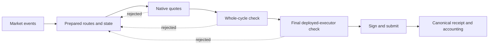

<p align="center"></p>

<p align="center">
  <a href="README.md"></a>
  <a href="README.zh-CN.md"></a>
</p>
<p align="center">
  <a href="https://github.com/MonadWorks/atomic-searcher/actions/workflows/ci.yml"></a>
  
  
  
  <a href="LICENSE"></a>
  
</p>

<p align="center"><strong>An atomic arbitrage implementation, and an honest record of the experiment behind it.</strong></p>
<p align="center"><a href="#what-is-here">What is here</a> · <a href="#quick-start">Quick start</a> · <a href="#how-it-works">Architecture</a> · <a href="docs/RESEARCH_NOTES.md">Research notes</a> · <a href="SECURITY.md">Security</a></p>

## Why publish this?

We tried to turn short-lived price differences on Base into profitable atomic
transactions using callback or flash liquidity. The implementation grew to cover
market discovery, execution simulation, several strategy families, signing,
submission and receipt accounting.

**The experiment did not establish sustained live profitability.** The retained
accounting record contains no verified profitable settlement. Local tests can
exercise successful transactions on synthetic markets; that is different evidence
from detecting an opportunity early enough and winning its inclusion on mainnet.

This release preserves the useful implementation, regression cases and lessons.
Personal deployments, wallets, provider credentials, raw operating data and the
sequence of local release copies are excluded.

## What is here

| Area | Implementation |
| --- | --- |
| Market data | WebSocket activity, HTTP recovery, bounded provider budgets and authenticated pool discovery |
| Route search | Incremental route indexes, prepared routes, concentrated-liquidity arithmetic and amount-aware quotes |
| Atomic cycles | V2, V3 and Slipstream routes; a separate executor for supported hookless V4 pairs |
| Additional strategies | Protocol liquidation, fixed-conversion cycles and supported order/auction or venue adapters |
| Execution | Whole-route checks, fee/profit limits, account ownership, nonce coordination and explicit submission |
| Accounting | Durable intent records, receipt reconciliation, reorg handling and bounded recovery |
| Inspection | Local status viewer and regression fixtures with readable public-market data |

Adapter presence describes code coverage. Each protocol, route and deployment
still requires its own current compatibility and economic validation. Flash or
callback liquidity supplies temporary trade inventory; the sender pays network
fees from its own balance.

## Quick start

Use a **source checkout** on macOS or Linux, Python 3.11+ and
[Foundry](https://getfoundry.sh/) (`forge` and `anvil`). The local validation uses
Foundry 1.5.1 and Solidity 0.8.33. Docker is not required.

```bash
git clone https://github.com/MonadWorks/atomic-searcher.git
cd atomic-searcher
python3 -m venv .venv
source .venv/bin/activate
python -m pip install -r requirements.lock

forge build
forge test
python -m pytest -q tests
```

Dependency and compiler installation need a connection. The Python tests block
external network connections in the test process and use mocks or temporary
loopback Anvil chains. They do not require an RPC account, funded wallet or real
transactions. Keep Anvil installed: some integration tests otherwise skip.

Inspect available commands without starting a service:

```bash
python -m searcher --help
```

An optional, bounded public-data exercise:

```bash
python -m searcher prepare --blocks 2
python -m searcher scan
```

`prepare` queries live public RPC; `scan` evaluates the saved snapshot locally.
Neither signs or submits transactions. These commands are examples for inspecting
the pipeline, not historical profit or competition proofs.

### Configuration and live operation

`config/base.json` contains public protocol settings and a **dummy owner**.
Wallet import, deployment and trading commands reject that owner before opening
a wallet. Keep personal settings in ignored `config/local.json`, and select them
with `--config config/local.json`. Read [SECURITY.md](SECURITY.md) first.

Signing exists in the code, but this README intentionally starts with reproducible
local tests. `launch`, `trade` and `setup-executor` are explicit financial actions;
they can deploy contracts or spend fees when configured with a real wallet.
There is no bundled account, pre-authorized spender, scheduler or remote status
publisher.

`policy.mode = "shadow"` describes the observation configuration; it is **not** a
signing lock on explicit financial commands. Atlas auction funding is disabled,
its bond target is zero, and no bond-increase authorization is included. Enabling
auction participation requires separately choosing its funding settings.

## How it works



The first quote is a filter. The whole-cycle check includes actual token and
callback behavior. The final call uses the deployed executor and the transaction's
fee, gas and profit parameters. A successful preflight is still followed by an
inclusion race: state may change before the transaction lands.

The later implementation separates fresh activity from historical catch-up,
prioritizes prepared routes, reuses pool fees and measured gas, and wakes execution
when a candidate is ready. These changes remove specific local delays; they do
not establish a winning latency budget for every market.

## Project map

```text
searcher/          Data, discovery, strategy, execution and accounting modules
src/               Solidity executors and read-only quote/state helpers
test/              Solidity tests with synthetic markets
tests/             Python regressions and loopback integration tests
tests/fixtures/    Inspectable public-market regression inputs
config/            Public example configuration and protocol bootstrap data
tools/live-view/   Local status viewer
tools/check_publication.py  Repository privacy and packaging checks
docs/              Research outcome and contribution guidance
```

## What the experiment taught us

- **First-seen timing matters.** A batch containing both the price-changing trade
  and the competing arbitrage cannot prove an actionable earlier opportunity.
- **Positive quotes need executable context.** Transfer behavior, dynamic fees,
  liquidity and account state can change the result of the whole transaction.
- **Every round trip consumes opportunity lifetime.** Additional validation can
  protect funds while also arriving too late; measure the complete path.
- **Keep evidence separate.** Quote surplus, successful preflight, broadcast,
  canonical receipt and realized net income are different states.
- **Operational data needs a lifecycle.** Repeated local releases and raw session
  snapshots consumed substantial disk space. They are not part of this release.

See [Research notes](docs/RESEARCH_NOTES.md) for the observed outcome and the
boundaries of the evidence, and [Contributing](CONTRIBUTING.md) for development.

## License

GPL-2.0-or-later for the combined project, with existing file-level MIT notices
preserved. See [LICENSE](LICENSE) and [THIRD_PARTY_NOTICES.md](THIRD_PARTY_NOTICES.md).
