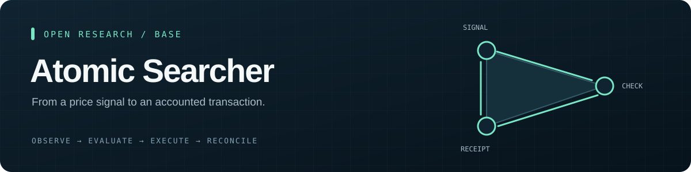
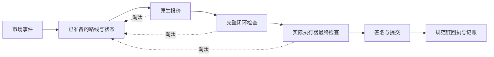

<p align="center"></p>

<p align="center">
  <a href="README.md"></a>
  <a href="README.zh-CN.md"></a>
</p>
<p align="center">
  <a href="https://github.com/MonadWorks/atomic-searcher/actions/workflows/ci.yml"></a>
  
  
  
  <a href="LICENSE">
  </a>
</p>

<p align="center"><strong>一套原子套利实现，也是一份如实保留的实验记录。</strong></p>
<p align="center"><a href="#包含什么">包含什么</a> · <a href="#快速开始">快速开始</a> · <a href="#执行流程">执行流程</a> · <a href="docs/RESEARCH_NOTES.md">研究记录</a> · <a href="SECURITY.md">安全说明</a></p>

## 为什么开源

这个实验尝试利用回调融资或闪电流动性，把 Base 上短暂的价格差转化为有利润的原子交易。实现逐步覆盖了市场发现、报价、完整交易检查、多类策略、签名提交和回执记账。

**实验尚未证明能够持续实盘盈利。** 保留的账本中没有已验证的盈利结算。本地合成市场可以检验成功执行的交易，但“及时发现真实机会并赢得主网成交”需要另外的证据。

这次开源保留可复用的实现、回归案例和经验。个人部署、钱包、节点凭证、原始运行数据和反复生成的本地版本副本都不在公开仓库中。

## 包含什么

| 部分 | 已有实现 |
| --- | --- |
| 市场数据 | WebSocket 活动推送、HTTP 恢复、有界节点预算与池子身份校验 |
| 路线搜索 | 增量路线索引、预先准备的路线、集中流动性整数计算与按金额报价 |
| 原子兑换 | V2、V3、Slipstream 路线；支持的无 hook V4 双池独立执行器 |
| 扩展策略 | 协议清算、固定兑换闭环，以及支持的订单、拍卖和交易场所适配器 |
| 交易执行 | 整条路线检查、费用与利润门槛、账户权限、nonce 协调和显式提交 |
| 账务恢复 | 持久化交易意图、回执核对、链重组处理与有界恢复 |
| 可观察性 | 本机状态页和可直接审阅的公开市场测试夹具 |

适配器的存在表示实现范围；具体协议、路线和部署仍需验证当前兼容性与经济条件。闪电或回调流动性提供的是交易中的临时资金，网络手续费由发送账户支付。

## 快速开始

使用 macOS 或 Linux、Python 3.11+，并安装 [Foundry](https://getfoundry.sh/) 的 `forge` 和 `anvil`。本地验证使用 Foundry 1.5.1、Solidity 0.8.33。采用源码检出运行，不需要 Docker。

```bash
git clone https://github.com/MonadWorks/atomic-searcher.git
cd atomic-searcher
python3 -m venv .venv
source .venv/bin/activate
python -m pip install -r requirements.lock

forge build
forge test
python -m pytest -q tests
```

安装依赖和编译器需要联网。Python 测试默认阻止测试进程访问外网，使用 mock 或临时的本机 Anvil 链；不需要节点账号、真实钱包或链上资金。请安装 Anvil，否则部分整链路测试会跳过。

查看命令，不启动服务：

```bash
python -m searcher --help
```

也可以选择一个有范围限制的公开数据示例：

```bash
python -m searcher prepare --blocks 2
python -m searcher scan
```

`prepare` 会读取真实公开 RPC，`scan` 在本地分析保存的快照。这两个命令不签名、不提交交易；它们用于理解数据流程，不是历史盈利或竞争胜率的证明。

### 配置与实盘入口

`config/base.json` 只有公开协议设置和**示例 owner 地址**。导入钱包、部署和交易命令会在接触钱包之前拒绝这个示例地址。个人配置应放在被 Git 忽略的 `config/local.json`，通过 `--config config/local.json` 显式选择。先阅读 [安全说明](SECURITY.md)。

代码保留签名功能，快速开始以可复现的本地测试为入口。`launch`、`trade` 和 `setup-executor` 是明确的资金操作：接入真实钱包后可能部署合约或消耗手续费。仓库不附带账户、预授权收款方、定时任务或远程状态发布服务。

`policy.mode = "shadow"` 描述观察配置，**不会阻止显式资金命令签名**。Atlas 拍卖默认关闭，押金目标为零，也没有附带增加押金的授权；启用这类拍卖前需要另行明确配置资金设置。

## 执行流程



第一次报价用于筛选。完整闭环检查涵盖实际代币转账与回调行为；最终调用采用已部署执行器及交易实际的费用、gas、利润参数。预检成功后依然存在成交竞争，交易上链前的状态可能变化。

后期实现将及时消息与历史补读分开，优先接收已准备路线的事件，复用池费和测得的 gas，并在候选就绪时唤醒执行器。这些改动消除了明确的本地等待，但并未证明在所有市场都能获得足够的速度优势。

## 项目结构

```text
searcher/          数据、发现、策略、执行与账务模块
src/               Solidity 执行器和只读报价、状态辅助合约
test/              使用合成市场的 Solidity 测试
tests/             Python 回归与本机集成测试
tests/fixtures/    可直接审阅的公开市场回归数据
config/            公开示例配置与协议引导数据
tools/live-view/   本机状态页
tools/check_publication.py  仓库隐私与发布范围检查
docs/              研究结果与项目说明
```

## 实验留下的经验

- **首先看信息何时可得。** 同一批数据包含价格变动和对手套利时，不能据此证明我们曾提前看到可成交机会。
- **正价差要落实到完整交易。** 转账行为、动态费用、流动性和账户状态都会改变结果。
- **每次往返都会消耗机会寿命。** 检查可以保护资金，也可能到达太晚，需要测量从事件到提交的全过程。
- **把证据分开记录。** 报价毛利、预检成功、广播、规范链回执与实际净收入是不同状态。
- **运行数据需要清理周期。** 旧版本副本和逐轮原始快照曾占用大量磁盘；它们不应成为源码的一部分。

更多背景见 [研究记录](docs/RESEARCH_NOTES.md)，开发方式见 [贡献说明](CONTRIBUTING.md)。

## 许可证

组合项目采用 GPL-2.0-or-later，保留现有文件的 MIT 标识。详见 [LICENSE](LICENSE) 和 [第三方声明](THIRD_PARTY_NOTICES.md)。
